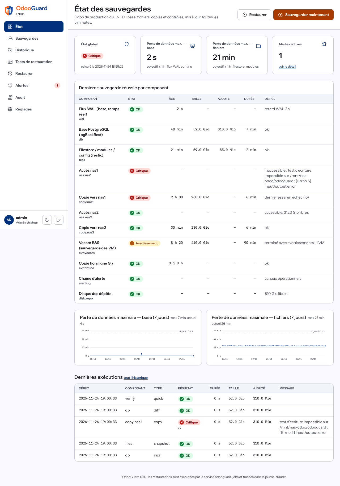

# Phase 2 : tableau de bord, alertes, Zabbix, Veeam et copie hors ligne

## 1. Ce qui est livré

| Brique | Rôle |
|---|---|
| **Tableau de bord** `https://192.168.8.81:8443` | État global, perte de données max. actuelle (base / fichiers), dernière sauvegarde réussie par composant (âge, taille, ajouté, durée), courbes de perte de données sur 7 jours, sauvegardes disponibles (fenêtre de restauration), historique, alertes, audit. **Lecture seule.** |
| **Alertes e-mail + Telegram** | Un message groupé par changement : nouveau problème, aggravation ou atténuation, rappel toutes les 4 h, « résolu ». Échecs de sauvegarde (`OnFailure`) envoyés immédiatement. |
| **Zabbix** | `odooguard-zabbix` + `UserParameter` + modèle avec découverte automatique des composants et déclencheurs. |
| **Veeam / copie G:\\** | Scripts PowerShell qui envoient un rapport après chaque exécution. L'absence de rapport réussi est elle-même une alerte. |

Principes :
- le tableau de bord ne lance aucune opération. Il peut être arrêté sans effet sur les
  sauvegardes, qui restent pilotées par les timers systemd ;
- si l'e-mail et Telegram tombent tous les deux, le composant « Chaîne d'alerte » passe en
  critique, et Zabbix et le tableau de bord le montrent ;
- Zabbix ne lit qu'une copie publique de l'état (`/var/lib/odooguard-public/status.json`,
  sans secret). Son compte n'a aucun droit sur les sauvegardes ni sur l'historique.

```
 timers systemd ── odooguard status --check --record (5 min) ──► status.json (privé)
                                    │                         └► /var/lib/odooguard-public/status.json ─► Zabbix agent 2
                                    └► Alerter ─► journal + e-mail + Telegram (changements seulement)
 Veeam (Windows) ─ Get-VeeamStatus.ps1 ─┐
 Copie G:\ (Windows) ─ Send-OdooGuardReport.ps1 ─┴► POST /api/v1/report/<nom> (jeton dédié) ─► historique
 Navigateur ──HTTPS──► odooguard-web (FastAPI, lecture seule) ◄── status.json + historique SQLite
```



## 2. Installation (OdooGuard)

Prérequis : la phase 1 est installée et fonctionne (`sudo odooguard status`).

```bash
cd /root/odooguard-src && git pull
```
```bash
sudo OG_IP=192.168.8.81 ./install/install-phase2.sh
```

Le script effectue les opérations suivantes :
- met à jour `/opt/odooguard` ;
- crée l'environnement Python `/opt/odooguard/venv` avec les versions figées de
  `requirements-web.txt` ;
- génère le certificat HTTPS auto-signé (10 ans) et les jetons Veeam et copie hors ligne ;
- ajoute les sections de la phase 2 à `odooguard.conf`, après en avoir fait une copie
  `.avant-phase2` ;
- active `odooguard-web` ;
- installe le `UserParameter` Zabbix si l'agent 2 est présent.

Sans accès Internet sur OdooGuard, préparer les paquets Python sur un autre poste :

```bash
pip download -r requirements-web.txt -d wheels
```

Copier le dossier `wheels`, puis :

```bash
sudo WHEELHOUSE=/root/wheels ./install/install-phase2.sh
```

### 2.1 Comptes du tableau de bord

```bash
sudo odooguard web-user add admin
```
```bash
sudo odooguard web-user list
```

Le mot de passe fait au moins 12 caractères et il est stocké haché (PBKDF2-SHA256, 600 000
itérations) dans `/etc/odooguard/web/users`. Cinq échecs depuis une même adresse bloquent
les connexions pendant 10 min. Chaque connexion est tracée dans l'audit.

Pare-feu : n'ouvrir le port 8443 qu'au réseau d'administration.

```bash
sudo ufw allow from 192.168.8.0/24 to any port 8443 proto tcp
```

### 2.2 E-mail

Dans `/etc/odooguard/odooguard.conf`, section `[smtp]` : `host`, `port`, `security`
(`starttls`, `ssl` ou `none`), `user`, `from` et `to` (plusieurs adresses séparées par des
virgules). Le mot de passe va dans un fichier séparé :

```bash
sudoedit /etc/odooguard/smtp.pass
```

Cas courants :

| Relais | Réglages |
|---|---|
| Relais interne sans authentification | `port = 25`, `security = none`, `user =` vide |
| Office 365 | `host = smtp.office365.com`, `port = 587`, `security = starttls`, compte de messagerie dédié (SMTP AUTH activé pour ce compte) |
| Gmail / Google Workspace | `smtp.gmail.com`, `587`, `starttls`, mot de passe d'application |

### 2.3 Telegram

1. Dans Telegram, ouvrir `@BotFather`, envoyer `/newbot` et noter le jeton.
2. Créer un groupe « Alertes OdooGuard », y ajouter le bot et y envoyer un message.
3. Récupérer l'identifiant du groupe depuis un poste ayant accès à Internet. Il commence
   par `-100` :

   ```bash
   curl -s "https://api.telegram.org/bot<JETON>/getUpdates" | python3 -m json.tool | grep -A3 '"chat"'
   ```

4. Enregistrer le jeton sur OdooGuard :

   ```bash
   sudoedit /etc/odooguard/telegram.token
   ```

   Puis renseigner `[telegram] chat_ids = -100…`, et `https_proxy` si la sortie Internet
   passe par un proxy. OdooGuard doit pouvoir joindre `api.telegram.org:443`.

### 2.4 Vérification des alertes

```bash
sudo odooguard alert-test
```

La sortie doit ressembler à :

```
journal    ok
email      ok
telegram   ok
```

Réglages, section `[alerts]` :
- `min_level` : `warning` ou `critical`, niveau minimal envoyé par e-mail et Telegram ;
- `repeat_hours` : intervalle des rappels ;
- `send_resolved` : envoi du message « résolu ».

Le journal système reçoit tout :

```bash
journalctl -t odooguard-alert
```

## 3. Zabbix

1. Sur OdooGuard, installer l'agent 2 (paquet `zabbix-agent2`, dépôt officiel Zabbix à la
   version du serveur) et le déclarer vers le serveur Zabbix. Relancer ensuite
   `install-phase2.sh`, qui dépose `/etc/zabbix/zabbix_agent2.d/userparameter_odooguard.conf`.
2. Vérifier en local :

   ```bash
   sudo -u zabbix /usr/local/bin/odooguard-zabbix overall
   ```
   ```bash
   zabbix_agent2 -t odooguard.discovery
   ```

3. Dans Zabbix : *Configuration → Modèles → Importer*
   `deploy/zabbix/zbx_template_odooguard.yaml` (format 6.0, importable en 6.0, 6.4 et 7.0).
   Lier le modèle « OdooGuard by Zabbix agent 2 » à l'hôte OdooGuard.

| Élément | Clé | Déclencheur |
|---|---|---|
| État global (0 OK, 1 avert., 2 crit., 3 inconnu) | `odooguard.overall` | =2 HAUTE ; =3 HAUTE |
| Âge de l'état | `odooguard.status.age` | > 20 min, ou pas de donnée depuis 15 min : HAUTE |
| Perte de données max. base / fichiers | `odooguard.rpo[db]`, `odooguard.rpo[files]` | > 1 h |
| Par composant découvert : niveau, âge, taille, durée, message | `odooguard.component[<nom>,level\|age\|size\|duration\|message]` | critique : HAUTE ; avertissement : AVERTISSEMENT |

Un état absent ou périmé renvoie toujours « inconnu » (3), jamais « OK ». Si la VM
OdooGuard ou son contrôle s'arrête, Zabbix alerte de son côté, indépendamment des alertes
d'OdooGuard.

## 4. Veeam et copie hors ligne G:\ (Windows)

Sur chaque machine Windows concernée, créer `C:\OdooGuard\` et y copier
`deploy/windows/*.ps1` ainsi que le jeton du composant :
- `/etc/odooguard/tokens/veeam` sur le serveur Veeam ;
- `/etc/odooguard/tokens/offline` sur le poste de copie G:\.

Restreindre ensuite les droits du fichier `.token` au compte de la tâche planifiée :

```powershell
icacls C:\OdooGuard\veeam.token /inheritance:r /grant:r "SYSTEM:R" "Administrateurs:R"
```

Le certificat est auto-signé : utiliser `-CertThumbprint <empreinte SHA-1>`, affichée par
`install-phase2.sh`, ou importer `/etc/odooguard/web/odooguard.crt` dans les autorités
racines de confiance de la machine.

### 4.1 Veeam B&R

Test manuel, en PowerShell administrateur sur le serveur Veeam :

```powershell
C:\OdooGuard\Get-VeeamStatus.ps1 -TokenFile C:\OdooGuard\veeam.token -CertThumbprint <EMPREINTE> -Verbose
```

Puis créer une tâche planifiée **toutes les heures**, avec un compte qui a au moins le rôle
« Veeam Backup Viewer ». Action :

```
powershell.exe -NoProfile -ExecutionPolicy Bypass -File C:\OdooGuard\Get-VeeamStatus.ps1 -TokenFile C:\OdooGuard\veeam.token -CertThumbprint <EMPREINTE>
```

Le script remonte chaque travail planifié : résultat, fin et taille.
- `failed` si un travail a échoué ou n'a pas tourné depuis 26 h (`-MaxAgeHours`) ;
- `warning` si un travail s'est terminé avec avertissements ;
- `success` sinon.

`-JobNames` restreint le relevé à certains travaux. **[À VÉRIFIER]** Les propriétés
utilisées (`FindLastSession()`, `Result`, `EndTime`, `BackupStats.BackupSize`) sont celles
de VBR 12 : faire le test manuel ci-dessus sur la version installée.

### 4.2 Copie hors ligne vers G:\

**Remplacé par la phase 3 bis** (`docs/installation-phase3bis.md`) : le script
`Copy-OdooGuardOffline.ps1` envoie lui-même son rapport. Le bloc ci-dessous ne sert que si
l'on garde un autre script de copie. Ajouter à la fin de ce script :

```powershell
# $ok, $taille, $debut : à alimenter par le script de copie
& C:\OdooGuard\Send-OdooGuardReport.ps1 -Name offline `
    -Status $(if ($ok) { 'success' } else { 'failed' }) `
    -Message "Copie G: $(if ($ok) { 'terminée' } else { 'en échec' })" `
    -SizeBytes $taille -DurationSeconds ((Get-Date) - $debut).TotalSeconds `
    -TokenFile C:\OdooGuard\offline.token -CertThumbprint <EMPREINTE>
```

Ajuster `[external:offline] max_age` au rythme réel de la copie : 8 jours par défaut, pour
une copie hebdomadaire.

## 5. Retour arrière (phase 2)

Le retour arrière n'a aucun effet sur les sauvegardes. La phase 1 continue de fonctionner :
alertes dans le journal, `OnFailure` et `status --check`.

```bash
sudo systemctl disable --now odooguard-web
```
```bash
sudo rm -f /etc/zabbix/zabbix_agent2.d/userparameter_odooguard.conf && sudo systemctl restart zabbix-agent2
```

Revenir à la configuration de la phase 1 (alertes dans le journal seulement) :

```bash
sudo cp -a /etc/odooguard/odooguard.conf.avant-phase2 /etc/odooguard/odooguard.conf
```

Supprimer le modèle dans Zabbix et désactiver les tâches planifiées Windows. Les tables
ajoutées à l'historique SQLite (`alerts`, `notifications`, `external_reports`) sont
ignorées par la phase 1 : inutile de les supprimer.

## 6. Tests

- Tests unitaires, sans dépendance externe : `python3 -m pytest -q`. Ils couvrent la
  politique anti-rafale (nouveau, silence, rappel, résolu, aggravation, regroupement,
  niveau minimal), la panne d'un canal, l'e-mail, Telegram (jeton jamais dans les erreurs),
  les rapports extérieurs et leurs jetons, les réponses Zabbix (état périmé jamais OK), et
  l'application web : authentification, cookie `HttpOnly`/`Secure`/`SameSite`, blocage
  après 5 échecs, échappement HTML, CSP, bandeau d'état périmé, API de rapport.
- Test de bout en bout `tests/integration/lab.sh` : **49 contrôles OK sur 49**.
  - Il installe réellement la phase 2 : venv et dépendances figées.
  - Il fait passer les messages de test et d'état par un faux serveur SMTP et une fausse
    API Telegram : une seule alerte groupée pour le NAS absent, aucun nouvel envoi au
    contrôle suivant, message « résolu » au retour du NAS.
  - Il interroge Zabbix sous le compte `nobody`, qui ne peut pas lire l'historique privé.
  - Il teste le tableau de bord en HTTPS, la page Sauvegardes sur un vrai dépôt
    pgBackRest, et le refus d'un rapport Veeam muni d'un mauvais jeton.
