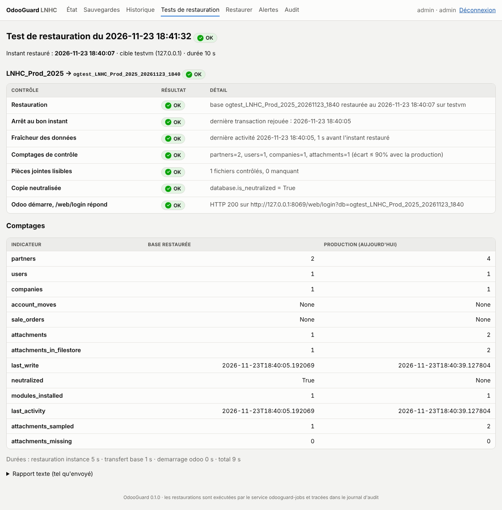
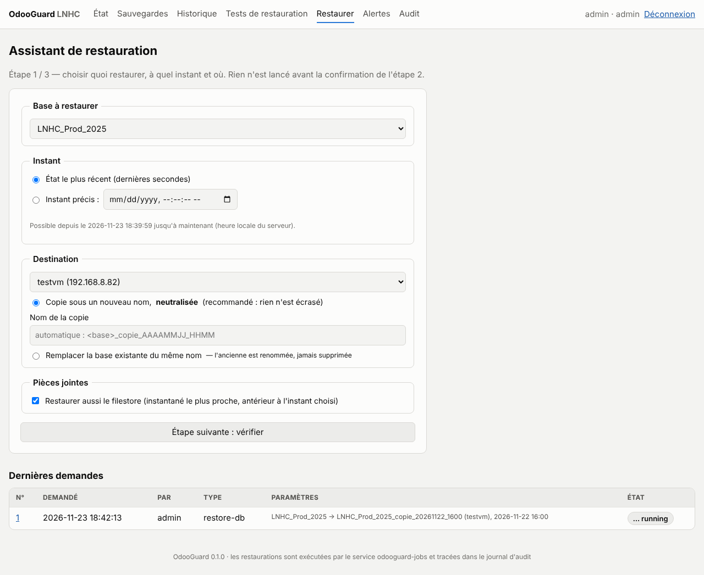

# Phase 3 : assistant de restauration web et test de restauration hebdomadaire

## 1. Ce qui est livré

| Brique | Rôle |
|---|---|
| **Test de restauration hebdomadaire** (`odooguard restore-test`, samedi 06:30) | Restaure `LNHC_Prod_2025` sur la VM de test à « hier 16:00 », neutralise la copie, démarre Odoo et contrôle la base. Le rapport part par e-mail et Telegram et reste consultable au tableau de bord. |
| **Assistant de restauration web** (menu « Restaurer ») | Restaure une base à un instant précis, en copie neutralisée ou en remplacement (admin). Le parcours se fait en 3 étapes : choix, vérification et confirmation, puis suivi en direct. |
| **Rôles** | `lecteur` : consultation. `operateur` : copies sans écrasement, test à la demande. `admin` : en plus, remplacement d'une base existante, y compris en production. |
| **Service `odooguard-jobs`** | Exécute les demandes du web. Il re-valide les droits et les paramètres, puis utilise le même code, les mêmes verrous et le même audit que la ligne de commande. |

### Contrôles du test de restauration

| Contrôle | Critique si… |
|---|---|
| Restauration | la restauration (pgBackRest, transfert, filestore) échoue |
| Arrêt au bon instant | le journal de PostgreSQL montre un rejeu au-delà de l'instant demandé, ou arrêté avant |
| Fraîcheur des données | une activité Odoo (messages) est postérieure à l'instant demandé. Avertissement si la dernière activité date de plus de 7 jours |
| Comptages de contrôle | partenaires ou utilisateurs à 0. Avertissement si l'écart avec la production dépasse 10 % (partenaires, utilisateurs, sociétés, écritures comptables, commandes, pièces jointes) |
| Pièces jointes lisibles | un fichier manque parmi 200 pièces jointes tirées au hasard dans le filestore restauré |
| Copie neutralisée | `database.is_neutralized` n'est pas posé : Odoo n'est alors **pas** démarré sur cette base |
| Odoo démarre, `/web/login` répond | pas de réponse HTTP 200 avec le formulaire de connexion dans le délai imparti (5 min) |

Le rapport indique aussi les durées : restauration de l'instance, transfert de la base,
démarrage d'Odoo et total. **C'est la mesure hebdomadaire du temps de reprise réel.**

La production n'est jamais modifiée : seules des requêtes de comptage en lecture y sont
faites, pour comparaison. Les bases de test s'appellent `ogtest_<base>_<AAAAMMJJ_HHMM>`.
Seule la dernière est conservée (`keep_last`), pour consultation manuelle sur la VM.



## 2. Préparation de la VM de test (192.168.8.82)

La VM doit être **isolée** : une copie de la production ne doit jamais pouvoir écrire aux
clients, appeler une API externe ou être prise pour la production.

1. **VM** : Debian, même version que server01 ; 4 vCPU, 8 Go de RAM ; disque ≥ 150 Go
   (base + filestore de `LNHC_Prod_2025` + marge). Dans l'ESXi, l'attacher à un groupe de
   ports ou VLAN de test, idéalement sans route vers Internet.

2. **Paquets, aux mêmes versions que server01** : PostgreSQL 15 depuis pgdg, puis Odoo 17
   depuis le même dépôt que server01 (voir `sources.list.d` dans l'export d'inventaire),
   et les dépendances Python des modules (`pip-freeze-system.txt` de l'export).

   ```bash
   sudo apt-get install -y postgresql-common
   ```
   ```bash
   sudo /usr/share/postgresql-common/pgdg/apt.postgresql.org.sh -y
   ```
   ```bash
   sudo apt-get install -y postgresql-15
   ```

   Modules additionnels : les copier depuis le miroir d'OdooGuard (`/opt/odoo/custom-addons`
   par exemple), ou les réinstaller avec `odooguard restore files --path … --push --target testvm --force`.

3. **Rôle PostgreSQL d'Odoo** :

   ```bash
   sudo -u postgres createuser --createdb odoo
   ```

4. **Configuration Odoo de la VM**, `/etc/odoo/odoo.conf`. En plus de la configuration
   habituelle :

   ```ini
   ; Plusieurs bases servies : /web/login?db=<nom> sélectionne la base
   dbfilter = .*
   list_db = True
   ; Défense en profondeur (la neutralisation désactive déjà les serveurs de courriel)
   smtp_server = 127.0.0.1
   smtp_port = 2
   ; Pas de tâches planifiées sur les copies
   max_cron_threads = 0
   ```

5. **Agent OdooGuard** : même procédure que pour server01. Lancer
   `install/install-server01.sh` avec `OG_IP=192.168.8.81`, puis ajouter dans
   `/etc/odooguard-agent.conf` :

   ```bash
   ALLOW_TEST_DROP=yes
   ```

   Cela autorise **sur cette VM seulement** la suppression des bases `ogtest_*` et de leur
   filestore. Sur server01, ce paramètre reste à `no` : l'agent refuse alors
   `db-drop-test`.

6. **Pare-feu de la VM**, nftables. Entrant : SSH et 5432 depuis OdooGuard, 8069 depuis le
   réseau d'administration. Sortant : uniquement OdooGuard et DNS. Pas de SMTP, pas d'Internet.

   ```bash
   sudo nft add table inet filter
   ```
   ```bash
   sudo nft add chain inet filter output '{ type filter hook output priority 0; policy drop; }'
   ```
   ```bash
   sudo nft add rule inet filter output oif lo accept
   ```
   ```bash
   sudo nft add rule inet filter output ct state established,related accept
   ```
   ```bash
   sudo nft add rule inet filter output ip daddr 192.168.8.81 accept
   ```
   ```bash
   sudo nft add rule inet filter output udp dport 53 accept
   ```

   Rendre ces règles permanentes :

   ```bash
   sudo sh -c 'nft list ruleset > /etc/nftables.conf'
   ```
   ```bash
   sudo systemctl enable nftables
   ```

7. Côté OdooGuard, vérifier la section `[target:testvm]` de `/etc/odooguard/odooguard.conf`
   (`host`, `pg_version`, `odoo_url = http://192.168.8.82:8069`, `is_production = no`) et
   l'empreinte SSH :

   ```bash
   sudo -u odooguard sh -c 'ssh-keyscan 192.168.8.82 >> ~/.ssh/known_hosts'
   ```

## 3. Installation sur OdooGuard

```bash
cd /root/odooguard-src && git pull
```
```bash
sudo ./install/install-phase3.sh
```

Le script :
- met à jour le code ;
- ajoute la section `[restore_test]` à la configuration, après une copie `.avant-phase3` ;
- installe `odooguard-jobs` (activé) et `odooguard-restore-test.timer` (**pas encore
  activé**) ;
- redémarre le tableau de bord.

Rôles des comptes du tableau de bord. Les comptes créés en phase 2 sont `lecteur` :

```bash
sudo odooguard web-user role admin admin
```
```bash
sudo odooguard web-user add marie operateur
```
```bash
sudo odooguard web-user list
```

## 4. Premier test, puis activation hebdomadaire

```bash
sudo odooguard restore-test
```

Durée attendue pour `LNHC_Prod_2025` : 45 à 90 min. Le rapport s'affiche en fin de
commande et part par e-mail et Telegram. S'il est réussi (ou réussi avec réserves
expliquées), activer le test hebdomadaire :

```bash
sudo systemctl enable --now odooguard-restore-test.timer
```

Réglages, section `[restore_test]` :

| Clé | Rôle |
|---|---|
| `databases` | bases testées |
| `point` | instant restauré, `hier 16:00` par défaut |
| `tolerance` | écart toléré sur les comptages |
| `keep_last` | nombre de bases de test conservées |
| `http_timeout` | délai de réponse d'Odoo |
| `max_age` | délai sans test réussi avant alerte critique, 8 jours |

Le composant « Test de restauration hebdomadaire » apparaît au tableau de bord et dans
Zabbix (`odooguard.component[restore-test,level]`).

Test à la demande : bouton « Lancer un test maintenant » sur la page « Tests de
restauration », avec le rôle opérateur.

## 5. Utiliser l'assistant de restauration



1. **Choix** : base, instant (le plus récent, ou une date et une heure à la seconde), destination
   (VM de test ou server01), mode. Le mode **copie sous un nouveau nom** est toujours
   neutralisé et n'écrase rien. Le mode **remplacement** est réservé au rôle admin.
2. **Vérification** : OdooGuard contrôle les droits, la fenêtre de restauration et
   l'existence de la base sur la cible, puis récapitule. En cas de remplacement, il faut
   **retaper le nom exact de la base**. En production, la page rappelle d'arrêter Odoo
   avant de confirmer.
3. **Suivi** : la demande est exécutée par `odooguard-jobs`. La page affiche le journal en
   direct, puis les comptages de contrôle de la base restaurée. Elle peut être fermée sans
   interrompre le travail.

Garde-fous :
- jeton anti-falsification de requête (CSRF) sur chaque formulaire ;
- paramètres re-validés à la soumission **et** par le service d'exécution ;
- une seule restauration à la fois (verrou) ;
- l'ancienne base est toujours renommée, jamais supprimée ;
- chaque demande et son exécution sont tracées dans l'audit, avec l'auteur `web:<compte>`.

La restauration de l'instance complète (`restore cluster`) et la reprise totale
(`restore full`) restent **réservées à la ligne de commande** : ce sont des opérations
rares, qui exigent une préparation (voir `restauration.md`).

## 5 bis. Configurer les NAS depuis le tableau de bord

Le menu **NAS** liste les NAS de destination, avec pour chacun l'état d'accès (test
d'écriture avec relecture) et la dernière copie. Droits :
- `lecteur` : consultation ;
- `operateur` : « Tester » ;
- `admin` : ajouter, modifier, retirer.

**Ajouter ou configurer un NAS** : partage (`//192.168.8.30/odoo`), dossier OdooGuard dans
ce partage (`odooguard`), compte, domaine Windows éventuel, mot de passe, version SMB,
espace libre minimal. À l'enregistrement, le service `odooguard-jobs` :
1. monte le partage sur `/mnt/odooguard/<nom>`, par une unité systemd
   `mnt-odooguard-<nom>.mount` et non par `/etc/fstab` ;
2. désactive une ligne `/etc/fstab` qui monterait déjà le même partage, en en gardant
   une copie `/etc/fstab.avant-odooguard-nas` ;
3. crée le dossier, teste l'écriture avec relecture et l'espace libre ;
4. met à jour la section `[destination:<nom>]` de `odooguard.conf`, avec une copie
   `odooguard.conf.avant-nas`.

Le résultat s'affiche en direct, comme pour une restauration.

Le **mot de passe** n'est jamais réaffiché, ni écrit dans la base, l'audit ou les
journaux. Il est déposé dans un fichier à usage unique (600), lu puis effacé par le
service de travaux, et stocké pour le montage dans `/etc/odooguard/nas-<nom>.cred`
(root, 600). Pour le changer, ressaisir le formulaire ; laisser le champ vide conserve
l'actuel.

Un NAS géré ainsi est **remonté automatiquement** s'il disparaît : redémarrage du NAS
ou coupure réseau. Le contrôle des 5 minutes et chaque copie le tentent avant de
signaler le NAS comme absent.

**Retirer** un NAS (retaper son nom) : OdooGuard arrête d'y copier et le démonte. Les
sauvegardes déjà présentes sur le NAS sont **conservées**.

Sécurité : seul le service de travaux peut monter un NAS, via
`/usr/local/sbin/odooguard-nas-helper`. C'est l'unique programme que le compte
`odooguard` peut lancer en root pour cela (`/etc/sudoers.d/odooguard`). Il n'accepte que
quatre actions (`apply`, `ensure`, `status`, `remove`), valide chaque argument, impose le
point de montage et les options de montage. Le mot de passe passe par l'entrée standard,
jamais par la ligne de commande.

## 5 ter. Planification, notifications et utilisateurs depuis le tableau de bord

Menu **Réglages**. La consultation est ouverte à tous les rôles, la modification est
réservée au rôle admin.

| Page | Ce qu'on y fait |
|---|---|
| **Planification** | Pour chaque type (base complète, différentielle, incrémentale, fichiers, copie NAS, vérifications, maintenance, test de restauration) : la planification actuelle et la prochaine exécution. On peut la modifier (heures fixes certains jours, toutes les heures sur une plage, intervalle régulier, ou expression systemd avancée), la suspendre ou l'activer, ou rétablir la planification d'origine. |
| **Notifications** | Serveur SMTP (serveur, port, sécurité, compte, mot de passe, expéditeur, destinataires), bot Telegram (jeton, conversations, proxy), niveau minimal, rappel, message « résolu ». Bouton **Envoyer un message de test**, et bouton **Trouver mes conversations Telegram** qui affiche l'identifiant à renseigner. |
| **Utilisateurs** | Créer un compte, changer son rôle, réinitialiser son mot de passe (12 caractères minimum), le supprimer. On ne peut ni se supprimer soi-même, ni supprimer ou rétrograder le dernier administrateur. |

Fonctionnement :
- chaque changement est appliqué par `odooguard-jobs`, qui affiche le résultat, puis tracé
  dans l'audit ;
- la configuration modifiée est vérifiée après écriture. Si elle devient illisible,
  l'ancienne version est rétablie automatiquement, et une copie
  `odooguard.conf.avant-tableau-de-bord` est conservée ;
- **les secrets** (mot de passe SMTP, jeton Telegram, mots de passe des comptes) ne sont
  jamais réaffichés ni écrits dans la base ou l'audit. Le mot de passe d'un compte est
  haché par le tableau de bord avant transmission ;
- la planification est écrite dans un fichier complémentaire
  `/etc/systemd/system/<minuteur>.d/odooguard-planification.conf`, par le programme root
  `odooguard-schedule-helper`. Ce programme n'accepte que les minuteurs OdooGuard (le
  contrôle d'état toutes les 5 min n'est pas modifiable) et des expressions validées par
  `systemd-analyze`.

Si vous espacez une sauvegarde, adaptez les seuils d'alerte correspondants
(`[thresholds]`), sinon une alerte « trop ancienne » apparaîtra.

## 6. Retour arrière

```bash
sudo systemctl disable --now odooguard-restore-test.timer odooguard-jobs.service
```

Sans `odooguard-jobs`, l'assistant enregistre les demandes mais ne les exécute plus.
Pour retirer aussi le menu « Restaurer », repasser tous les comptes en `lecteur` :

```bash
sudo odooguard web-user role <nom> lecteur
```

Restaurer la configuration de la phase 2 :

```bash
sudo cp -a /etc/odooguard/odooguard.conf.avant-phase3 /etc/odooguard/odooguard.conf
```

Sur la VM de test, supprimer les bases `ogtest_*` si besoin, puis repasser
`ALLOW_TEST_DROP=no`.

## 7. Tests

- **Tests unitaires** (`python3 -m pytest -q`, 124 tests). Ils couvrent :
  - la détection d'un rejeu arrêté trop tôt ou trop tard ;
  - la comparaison des comptages avec la production ;
  - les cas critiques : pièce jointe manquante, copie non neutralisée, activité
    postérieure à l'instant, base vide, Odoo muet ;
  - le refus de viser la production et le nettoyage des anciennes bases ;
  - les rôles, les règles de restauration (remplacement réservé à l'admin, confirmation
    exacte, instant futur refusé, copie toujours neutralisée) et le service d'exécution
    (auteur tracé) ;
  - côté web : jeton anti-falsification, paramètres trafiqués refusés, récapitulatif,
    page de rapport.
- **Test de bout en bout** (`tests/integration/lab.sh`) : **68 contrôles OK sur 68**,
  dont, pour la phase 3 :
  - le test de restauration complet à l'instant T sur une « VM de test », avec un faux
    binaire Odoo qui pose réellement la neutralisation et un faux serveur `/web/login` ;
  - le rapport envoyé par e-mail et Telegram, puis archivé ;
  - le nettoyage des anciennes bases, et le refus par l'agent de supprimer une base hors
    `ogtest_` ;
  - le parcours de l'assistant en HTTPS par un opérateur, exécuté par `odooguard-jobs`,
    avec une copie neutralisée et l'auteur `web:oscar` dans l'audit.
